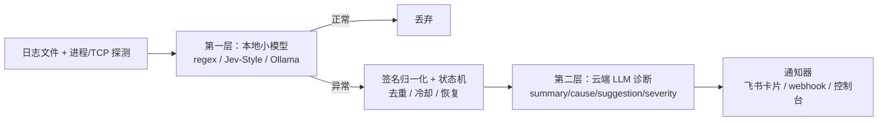

# jev-sentinel

> 本地小模型第一层异常判断 + 云端 LLM 诊断 + 飞书/webhook 告警的通用日志运维哨兵。
> A general-purpose log ops agent: local small-model first-pass triage, cloud LLM diagnosis, Feishu/webhook alerting.

## 是什么

`jev-sentinel` 是一个独立运行的运维 agent：持续扫描日志文件与进程/端口健康状态，先用**本地小模型**（默认 Jev-Style 0.8B，几乎零成本）判断「这一行是不是异常」，**只有确认异常后才调用云端 LLM** 生成原因与处理建议，最后通过飞书卡片（或 webhook / 控制台）告警。

它把「本地小模型省钱做第一层 + 云端大模型出结论 + 飞书转发」这套打法，抽象成一个可配置、可复用的通用方案。你只需要写一个 TOML 配置，告诉它看哪些日志、用什么模型、发到哪里。

### 特性

- **成本敏感**：异常判断全在本地小模型完成，云端 LLM 只在确认异常时被调用，日常几乎不消耗 token。
- **模型故障不断链**：本地模型加载/推理失败自动回退正则；云端诊断失败退回原始日志，告警照发。
- **去重与生命周期**：错误签名归一化（剥离时间戳、UUID 等易变字段）+ 首次告警 / 冷却 / 连续多轮消失才发「已恢复」的状态机。
- **零强制依赖**：核心只用 Python 标准库；Jev-Style、Ollama 均为可选依赖。
- **增量读取**：按字节偏移只读日志新增内容，首轮自动基线（不把历史错误重复告警）。

## 架构



三层职责：

1. **采集/探测**：日志 glob 扫描（字节偏移增量读取 + 首轮基线）、进程存活、TCP 端口可达。
2. **第一层判断**：本地小模型判断「是否异常」。默认 Jev-Style 决策模型；也可用 Ollama 挂任意本地模型；两者失败都回退到正则，保证监控链路不因模型故障中断。
3. **第二层诊断**：确认异常后，调用 OpenAI 兼容接口（MiniMax / DeepSeek / OpenAI / 本机 Ollama 等）输出结构化结论，并兼容推理模型的 `<think>` 块与 ```json 围栏。

## 快速开始

### 安装

```bash
# 核心（仅标准库）
pip install -e .
# 需要本地 Jev-Style 决策模型时（会拉取 HuggingFace 权重）
pip install -e ".[jev]"
```

### 配置

```bash
copy config.example.toml config.toml
```

至少修改三处：`[[logs]].path`（看哪些日志）、`[llm]`（云端诊断用哪个模型）、`[notifier]`（发到哪里）。

### 运行

```bash
# 常驻运行
jev-sentinel --config config.toml
# 单轮调试（只扫一轮就退出，观察日志输出）
jev-sentinel --config config.toml --once
# 未安装命令行时等价写法
python -m jev_sentinel --config config.toml --once
```

## 配置说明

所有配置都在 TOML 文件中，并可用 `JEV_SENTINEL_*` 环境变量覆盖（环境变量优先级更高）。敏感信息建议只放环境变量。

| TOML 键 | 环境变量 | 默认值 | 说明 |
|---|---|---|---|
| `agent.interval_seconds` | `JEV_SENTINEL_INTERVAL_SECONDS` | `60` | 扫描间隔（秒） |
| `agent.cooldown_seconds` | `JEV_SENTINEL_COOLDOWN_SECONDS` | `3600` | 同一告警冷却（秒） |
| `agent.grace_scans` | `JEV_SENTINEL_GRACE_SCANS` | `3` | 连续多少轮未见才发「已恢复」 |
| `agent.horizon_seconds` | `JEV_SENTINEL_HORIZON_SECONDS` | `86400` | 状态保留时长（秒） |
| `agent.max_lines_per_scan` | `JEV_SENTINEL_MAX_LINES_PER_SCAN` | `500` | 单轮最多判断行数（控成本） |
| `agent.timezone_hours` | `JEV_SENTINEL_TIMEZONE_HOURS` | `8` | 告警时间时区偏移 |
| `classifier.type` | `JEV_SENTINEL_CLASSIFIER_TYPE` | `regex` | `regex` / `jev` / `ollama` |
| `classifier.enabled` | `JEV_SENTINEL_CLASSIFIER_ENABLED` | `true` | 是否启用模型层 |
| `classifier.threshold` | `JEV_SENTINEL_CLASSIFIER_THRESHOLD` | `0.5` | 异常概率下限 |
| `classifier.model` | `JEV_SENTINEL_CLASSIFIER_MODEL` | 空 | Jev 模型 repo / Ollama 模型名；留空用内置 Jev-Style 0.8B Decision v3 |
| `classifier.base_url` | `JEV_SENTINEL_CLASSIFIER_BASE_URL` | 空 | 远端 jev-style / Ollama 地址 |
| `llm.base_url` | `JEV_SENTINEL_LLM_BASE_URL` | 空 | OpenAI 兼容接口地址 |
| `llm.model` | `JEV_SENTINEL_LLM_MODEL` | 空 | 诊断模型名 |
| `llm.api_key` | `JEV_SENTINEL_LLM_API_KEY` | 空 | API Key（建议走环境变量） |
| `notifier.type` | `JEV_SENTINEL_NOTIFIER_TYPE` | `console` | `console` / `feishu` / `webhook` |
| `notifier.webhook` | `JEV_SENTINEL_FEISHU_WEBHOOK` / `JEV_SENTINEL_NOTIFIER_WEBHOOK` | 空 | 飞书机器人或通用 webhook 地址 |
| `notifier.secret` | `JEV_SENTINEL_FEISHU_SECRET` / `JEV_SENTINEL_NOTIFIER_SECRET` | 空 | 飞书签名校验密钥 |
| `notifier.timeout` | `JEV_SENTINEL_NOTIFIER_TIMEOUT` | `5` | 通知请求超时（秒） |

`[[logs]]` 支持多条，每条含 `path`（必填，支持 glob）、`tail_bytes`、`max_lines`。`[health]` 含 `processes` 与 `tcp` 两个列表。

## 告警卡片示例

出现异常时飞书收到的是 interactive 卡片：

```json
{
  "config": { "wide_screen_mode": true },
  "header": { "template": "red", "title": { "tag": "plain_text", "content": "运维告警 · 出现" } },
  "elements": [
    {
      "tag": "div",
      "text": {
        "tag": "lark_md",
        "content": "**问题**：数据库连接超时\n**可能原因**：...\n**处理建议**：...\n**严重程度**：high\n\n日志签名：...\n时间：2026-10-20 10:00:00"
      }
    }
  ]
}
```

## 测试

```bash
python -m unittest discover -s tests -v
```

## 来源与背景

这套方案抽象自一个真实生产环境：通达信量化盯盘系统的运维监控 agent（`ops_agent.py`），它在本地用 Jev-Style 0.8B 决策模型做日志第一层判断、异常时才调云端模型生成原因并转发飞书卡片。本仓库去掉了通达信/行情相关的具体实现，保留了可复用的三段式管线与状态机。

## License

[MIT](LICENSE)
